<h1 align="center">DSH Memory Plus</h1>

<p align="center">Chinese search, cross-session memory and reusable skills for DeepSeek Harness.</p>

<p align="center"><a href="README.md">简体中文</a> · <strong>English</strong></p>

<p align="center"><a href="#4-install">Install</a> · <a href="#keyboard-shortcuts">Shortcuts</a> · <a href="#demos">Search demo</a> · <a href="#1-packages">Packages</a> · <a href="docs/MEMORY-HOST-VERIFICATION.md">Verification</a></p>

> **Development update** · Five memory and skill shortcuts, with Windows Web walkthroughs. [View keys and visible effects →](#keyboard-shortcuts)<br>
> Available in the current source; not included in the published v0.2.2 asset.

130 automated tests and all 8 package checks pass. [Full bundle verification](docs/MEMORY-HOST-VERIFICATION.md) · [CJK host verification](docs/CJK-HOST-VERIFICATION.md)

<a name="demos"></a>

<details>
<summary><strong>Watch the search demo</strong> · Mixed text, supplementary Han, short queries and ASCII</summary>

<p align="center"></p>

Real engine output: supplementary Han queries of 1/2/3 code points, short-query fallback, ASCII and literal-wildcard controls. Supplementary Han is displayed as Unicode escapes for font compatibility; the engine queries the original code points. Generated from [the demo script](scripts/demo-cjk-search.mjs) using an in-memory index and a synthetic live session.

</details>

Eight community memory packages for DeepSeek Harness (DSH): CJK search, tool-result dedup, hybrid vector/full-text recall, cross-session core memory, traceable compaction and skill management. Pinned memories and skills carry provenance and cannot be changed by model tools or background evolution. Phases 0–3 are implemented; the CJK backend is verified with live and cold history in the complete `0.2.0-rc.2` Web host. Native desktop shells await community validation.

<details>
<summary>Host compatibility: DSH <code>&gt;=0.1.5-rc.3 &lt;0.3.0</code></summary>

DSH `>=0.1.5-rc.3 <0.3.0` (cordis `^4.0.1`), verified on `0.1.5-rc.3` and `0.2.0-rc.2`. `ctx.sessionQuery` is provided by this repo's CJK plugin as a subclass of upstream `SessionQueryEngine`, so it must resolve the same `@deepseek-ai/dsh-session-query` copy as the host; otherwise the host gets a service instance without `observeSession()`. See [issue #1](https://github.com/QIANLING-0831/dsh-memory-plus/issues/1) and the [host version contract](packages/dsh-session-query-sqlite-cjk/README.md).

</details>

---

## When this bundle helps

Use this bundle when Chinese history is hard to search, details are hard to recover after compaction, or project rules have to be repeated in every new session. It connects retrieval, persistent facts and reusable skills to DSH's existing services.

Main capabilities:

1. **Chinese substring search** — trigram dual tables + a 1–2 char LIKE fallback, including mixed text and supplementary Han; see the query comparison below.
2. **Skill self-evolution** — `skill_write/delete/list` plus a background reflection loop that distills reusable skills from finished turns (Hermes-style learning loop, zero request-path overhead).
3. **A user layer the model cannot write** — skills and standing memories carry **provenance**; hand-written files and anything pinned with `/skill-pin` or `/memory-pin` are refused to model tools and to the background loop, and every refusal is written to an audit log.
4. **A topic for mistakes** — `lesson` and `correction` are first-class fact topics, so "what went wrong" is not buried in `general`.
5. **Token dedup** — hash-dedup of repeated tool results, saving input tokens.
6. **KV-safe stable injection** — injection discipline derived from source-level findings (`buildRequest` deepFreeze / KV prefix-cache invalidation / persistent-log pollution).
7. **Compaction provenance** — source locators attached to summaries (spill path / file / seq range) help recover original details.

Historical ecosystem survey and license checks: [`docs/DSH-MEMORY-ECOSYSTEM.md`](docs/DSH-MEMORY-ECOSYSTEM.md).

---

## 1. Packages

| Package | What it does | Phase |
|---|---|---|
| [`dsh-session-query-sqlite-cjk`](packages/dsh-session-query-sqlite-cjk) | CJK-capable `sessionQuery` provider: FTS5 dual tokenizer (unicode61 + trigram) with automatic routing and a 1–2 char CJK LIKE fallback | 0 |
| [`dsh-tool-result-dedup`](packages/dsh-tool-result-dedup) | Hash-dedup of repeated tool results (`git status` / `ls` / repeated `read`) → pointer, saving input tokens | 0 |
| [`dsh-memory-index`](packages/dsh-memory-index) | Hybrid memory search service `ctx.memorySearch`: sqlite-vec vector arm + FTS5 lexical arm → RRF fusion; incremental per-event embedding; file-tag filtering | 1 |
| [`dsh-memory-tool`](packages/dsh-memory-tool) | Model-facing `memory_search` tool: bounded hybrid recall over the current session's earlier conversation | 1 |
| [`dsh-compaction-locator`](packages/dsh-compaction-locator) | Near-lossless compaction: every `<compacted-summary>` carries Exact Sources locators (spill path / file path / seq range) | 2 |
| [`dsh-memory-core`](packages/dsh-memory-core) | Cross-session core memory: workspace fact store + stable system-prompt section injection (KV-safe) + `memory_remember` tool + a **user-pinned `[pinned]` layer no tool can change** and `/memory-pin` `/memory-unpin` `/memory-list` commands | 2 |
| [`dsh-memory-skills`](packages/dsh-memory-skills) | Skill manager + background self-evolution: `skill_write/delete/list` persist DSH-native skill files; a timer-driven reflection loop distills reusable skills from finished turns; **provenance + `/skill-pin` so the model cannot rewrite a user's skills** | 3 |
| [`dsh-memory-bundle`](packages/dsh-memory-bundle) | Meta-bundle: one-command install of everything, auto-disabling conflicting base rows | integration |

---

## 2. Background: the DSH memory pipeline today

### 2.1 `unicode61` is effectively unusable for Chinese (upstream defect)

`dsh-session-query-sqlite` uses the FTS5 `unicode61` tokenizer, which does **not segment CJK text**: a run of Han characters becomes a single token. Measured (node:sqlite + FTS5):

| Query against `索引优化减少Token消耗的句子` | unicode61 (upstream) | trigram (this plugin) |
|---|---|---|
| `Token消耗` | ❌ 0 hits | ✅ hits |
| `"索引优化"` (whole phrase) | ❌ 0 hits (must reproduce the full sentence) | ✅ hits |

### 2.2 The memory pipeline is "write-only"

- **compaction**: lossy summaries; old details vanish unless spilled at the time;
- **spill**: large results leave context, but recall means the model guessing paths with `read`/`grep`;
- **indexing** (FTS5) only serves callers that actively search — it is **never wired back into model context**.

**Core insight**: make indexing a real channel from memory back into context — old content becomes precisely retrievable, so the context tail can stay short, compaction pressure drops, and identical content is never re-sent.

---

## 3. Architecture: three-layer memory + entry tags + incremental driving

| Layer | Content | Write semantics | Storage |
|---|---|---|---|
| working | current context (surface cursor) | slides every step | no store — it is the context |
| archival | full text of old events (shadowed/log-only) | **append-only** (log immutable; derived tags updatable) | derived SQLite: chunks + vec0 vectors + FTS5 |
| core | distilled cross-session facts (preferences/conventions/environment/decisions) | **CRUD**: hash dedup + similarity merge | derived SQLite: `core_facts` |
| dedup | tool-result hash table | pointer on hit | in-process (Phase 0 MVP) |
| skills | reusable skill files | CRUD via `skill_write/delete` + background evolution, provenance-tagged (`metadata.source`) | DSH-native Markdown files (`$DSH_HOME/skills`) |

### Query pipeline

```
Stage 1  entry exact filter (file:/tool:/hash:, zero embedding) → candidate set
Stage 2  hybrid retrieval: FTS5 lexical + vector semantic → RRF fusion → rerank
Stage 3  merge candidates → pointers for already-visible items → budget trim
```

### Background self-evolution (Hermes-style, DSH-disciplined)

`dsh-memory-skills` runs a fire-and-forget timer (default 60 s) that scans live sessions past a per-session watermark. Heuristic gates (assistant message length), a cooldown, and a bounded event window keep LLM cost flat. When triggered, it asks the model once — strict JSON contract — whether a finished turn produced a reusable skill, then writes/updates a DSH-native skill file atomically. Everything is logged to the derived DB (`skill_events`), and skill files are plain Markdown, so they survive plugin removal.

---

## 4. Install

Install the versioned Release bundle with one command:

```sh
dsh plugin --profile headless add https://github.com/QIANLING-0831/dsh-memory-plus/releases/download/v0.2.2/dsh-memory-bundle-0.2.2.tgz
```

Requires Node.js 24, a compatible DSH, and pnpm on PATH. Replace `headless` with `web` for a Web profile. The `.tgz` contains the patch and all seven plugin implementations, exposed as bundle subpaths. DSH installs external dependencies automatically: no source checkout, per-package registration, separate `pnpm install`, or retained source directory is required. The package has no `workspace:`, `file:` or `link:` dependencies.

The fixed URL points to the installable asset in [v0.2.2](https://github.com/QIANLING-0831/dsh-memory-plus/releases/tag/v0.2.2), with a `SHA256SUMS` file. It is not the automatically generated Source code archive. These packages are not published to npm. `node scripts/pack-release.mjs` rebuilds the standalone tarball; the tag workflow tests and publishes Release assets without npm credentials.

From an existing checkout, use `bash scripts/install.sh headless` (Linux/macOS) or `.\scripts\install.ps1 -Profile headless` (Windows/PowerShell).

Plugin defaults live in [`packages/dsh-memory-bundle/cordis.patch.yml`](packages/dsh-memory-bundle/cordis.patch.yml).

All four database paths are optional. Explicit `config.path` wins; otherwise an existing `.dsh-verify/<name>.db` in the working directory is reused, falling back to `$DSH_HOME/<name>.db` (`~/.dsh` when `DSH_HOME` is unset or empty). Default paths become absolute at initialization. New installations do not create `.dsh-verify`; existing profile paths still work. Persistent databases use WAL and a 5-second busy timeout; CJK still honors an explicit `journalMode`.

This path change reuses existing files without automatically moving or clearing memories. `memory-core.db` contains ordinary and pinned memories; `memory-skills.db` contains skill audit history and evolution progress. To move them, stop every DSH process using them, back up and move the databases with any remaining `-wal` / `-shm` files, then configure absolute paths in the profile patch. These records cannot be rebuilt from a search index. Set the old location explicitly before changing your working directory.

New profiles under one `DSH_HOME` share databases unless absolute paths are overridden by plugin id. The standing-memory prompt cache detects writes by other connections. Instances sharing `memory-index.db` must use the same embedding model and `dims`.

> **Host version requirement: DSH `>=0.1.5-rc.3 <0.3.0` (cordis `^4.0.1`), verified on 0.1.5-rc.3 and 0.2.0-rc.2.**
> The `<0.3.0` upper bound is deliberate: DSH 0.2.0 added a hard pre-install/pre-boot peer gate (`evaluatePluginCompatibility`), and a declared range that does not match makes the whole tree refuse to load (issue #3). Only 0.1.5-rc.3 and 0.2.0-rc.2 have actually been exercised, so a future 0.3.0 should **fail loudly and be verified**, not be silently claimed compatible. See the "host version contract" section of [`packages/dsh-session-query-sqlite-cjk/README.md`](packages/dsh-session-query-sqlite-cjk/README.md).

## 5. Usage

The model gets five tools:

- `memory_search(query, limit, max_chars, file?)` — bounded hybrid recall over the current session's earlier conversation;
- `memory_remember(content, topic?)` — write a durable cross-session fact; it appears at the top of later requests in the same workspace (`## Persistent Memory` block). Topics include `preference` / `convention` / `environment` / `decision` / **`lesson`** / **`correction`** / `general`;
- `skill_write(name, description, whenToUse?, content)` — create/update a reusable skill **a model wrote** (DSH-native skill file, immediately visible to the session skill catalog);
- `skill_delete(name)` / `skill_list()` — delete / list skills, with provenance (`(managed:model)` / `(managed:evolve)` / `(human)` / `(pinned)`).

**The user layer (slash commands the model cannot reach).** `/skill-pin <name>` and `/skill-unpin <name>` pin a skill file; `/memory-pin [topic] <text>`, `/memory-unpin <id|text>` and `/memory-list` manage standing memories. These run through `ctx.commands`: a slash line executes against the agent, is never submitted to the model, and no model-facing tool can dispatch one — so a pin is structural, not advisory. Files the user wrote by hand or pinned are refused to `skill_write` / `skill_delete` / the evolution loop, and each refusal lands in the `skill_events` audit log. Design and measurements: [`docs/PROVENANCE-AND-PIN.md`](docs/PROVENANCE-AND-PIN.md).

<a name="keyboard-shortcuts"></a>

### Memory and skill shortcuts

**Windows browser** · DSH `0.2.0-rc.2` · **Development source, unreleased**

Press all four keys together in the main conversation. List actions show results immediately; search and pin actions prepare a command for you to complete and confirm.

| Shortcut | Action and visible effect |
|:---|:---|
| <kbd>Ctrl+Alt+Shift+F</kbd> | **Search history**<br>Prepare `/memory-search` in the composer; enter keywords and press Enter for results |
| <kbd>Ctrl+Alt+Shift+M</kbd> | **List memories**<br>Add a `memory-list` result row to the conversation; click to expand |
| <kbd>Ctrl+Alt+Shift+P</kbd> | **Pin a memory**<br>Prepare `/memory-pin`; complete the text and press Enter to confirm |
| <kbd>Ctrl+Alt+Shift+S</kbd> | **List skills**<br>Add a `skill-list` result row to the conversation; click to expand |
| <kbd>Ctrl+Alt+Shift+K</kbd> | **Pin a skill**<br>Prepare `/skill-pin`; enter a name and press Enter to confirm |

Existing drafts and attachments are preserved. Modals and terminals retain input ownership. These commands do not call the model. `Ctrl+F` keeps browser page-find. Use `/memory-unpin` and `/skill-unpin` to remove a pin.

<details>
<summary><strong>Watch the actual interaction</strong> · Windows Web · Search history</summary>

<p align="center"></p>

More walkthroughs: [List memories](docs/shortcuts-memory-list.svg) · [Pin memory](docs/shortcuts-memory-pin.svg) · [List skills](docs/shortcuts-skill-list.svg) · [Pin skill](docs/shortcuts-skill-pin.svg)

</details>

Actual DSH page screenshots, in Chinese, captured on Linux Chromium using Windows key-mode emulation. Orange outlines and magnified regions are tutorial annotations; native Windows key delivery has not been verified. [Full guide and verification scope →](docs/SHORTCUTS.md)

<details>
<summary>Install the development source and check other platforms</summary>

Install the current checkout into the `web` profile. On Windows / PowerShell:

```powershell
.\scripts\install.ps1 -Profile web
```

Restart DSH and reload the page. Search for `memory plus` in the host shortcut settings to view or edit bindings. The shortcut-service baseline is DSH `0.2.0-rc.2`; hosts without that service retain existing memory features.

macOS defaults replace Ctrl with ⌘ and Alt with ⌥. Linux Desktop declares the Windows combinations. Linux browsers have no defaults under the host's policy and use the slash commands. Native Windows/macOS/Linux desktop key delivery awaits actual-device testing.

</details>

## 6. Verification

Real-harness results (headless profile): full-tree startup with 8 plugins ✅, `memory_remember` ✅, `memory_search` Chinese recall ✅ (3 real records), cross-session persistence ✅. A dedicated 2026-10-01 end-to-end run covered the provenance guards: three attempts by the model to overwrite/delete a hand-written skill and to overwrite a pinned one were all refused with the user's files byte-identical afterwards, the refusals were persisted as `skill_events` rows, and `memory_remember` stored a `lesson` fact through the real tool schema. Step-by-step verification: [`docs/VERIFICATION.md`](docs/VERIFICATION.md).

## 7. Roadmap & open items

- ✅ Phase 0: CJK search fix + tool-result dedup
- ✅ Phase 1: hybrid search service + `memory_search` tool
- ✅ Phase 2: near-lossless compaction + cross-session core memory + file entity index
- ✅ Phase 3: skill manager + background self-evolution
- ✅ Phase 3.1: provenance + the user-pinned layer (`/skill-pin`, `/memory-pin`), `lesson`/`correction` topics, additive schema migration
- ⏳ Real-machine trigger verification for compaction/dedup; bge real-embedding verification; interactive verification of the slash commands (a headless profile has no command adapter — see `docs/VERIFICATION.md` §6); auto recall injection once DSH provides a "non-persistent, tail-append" seam

## License

MIT. `dsh-session-query-sqlite-cjk` is a fork of `@deepseek-ai/dsh-session-query-sqlite` (MIT).
