# Memory Plus 快捷键

适用对象是本仓库的记忆/技能插件套件。快捷键由 bundle 的可选浏览器模块注册，后端服务与无界面的 profile 不依赖浏览器服务。当前源码包含这些功能；已发布的 v0.2.2 不包含。

## Windows 浏览器网页版：按下后究竟发生什么

下面的教程统一使用 **Windows 网页版的按键方式**。先打开 DSH 的主聊天页；组合键中的 Ctrl、Alt、Shift 和最后一个字母要同时按下。

| 完整快捷键 | 按下后立刻出现的画面 | 接下来由你手动操作 | 实际界面动图 |
|---|---|---|---|
| `Ctrl+Alt+Shift+F` | **底部输入框**自动出现 `/memory-search `，光标进入输入框 | 输入关键词，再按 Enter；**对话区**新增折叠的 `memory-search` 结果行，点击展开全文 | [搜索历史](shortcuts-effects.svg) |
| `Ctrl+Alt+Shift+M` | **对话区**直接新增折叠的 `memory-list` 结果行 | 点击结果行，展开常驻记忆及 `[pinned]` 标记 | [查看记忆](shortcuts-memory-list.svg) |
| `Ctrl+Alt+Shift+P` | **底部输入框**自动出现 `/memory-pin `；这时尚未固定任何内容 | 补全 `[topic] <text>`，按 Enter 确认；再查看列表可见 `[pinned]` | [固定记忆](shortcuts-memory-pin.svg) |
| `Ctrl+Alt+Shift+S` | **对话区**直接新增折叠的 `skill-list` 结果行 | 点击结果行，展开技能名称、描述和来源标记 | [查看技能](shortcuts-skill-list.svg) |
| `Ctrl+Alt+Shift+K` | **底部输入框**自动出现 `/skill-pin `；这时尚未固定技能 | 输入技能名称，按 Enter 确认；再查看列表可见 `pinned` | [固定技能](shortcuts-skill-pin.svg) |

`Ctrl+F` 继续提供浏览器的页面内查找。以上动作可在 DSH 的快捷键面板中改键。

### 动图的环境与来源

- **适用环境**：Windows 浏览器网页版，DSH `0.2.0-rc.2`；图中使用 DSH 自带深色主题。
- **采集环境**：Linux Chromium，`navigator.platform=Win32`；这是 Windows 按键模式的模拟验证，未采集原生 Windows 实机录屏。
- **画面**：真实 DSH 网页的逐帧截图，保留侧栏、对话区和输入框。橙框、说明及局部放大是外加讲解标注。
- **演示方式**：五个独立循环，每段只讲一个功能；明确区分快捷键的直接效果、手动输入、Enter 确认以及鼠标展开。减少动态效果时显示最后一步的静态画面。
- **数据**：合成会话、记忆与技能；[采集清单](shortcuts-demo.json)记录每一步的截图、按键、操作与实际结果，[原始截图](shortcuts-captures)可单独查看。


历史搜索原图对照：[按下前](shortcuts-captures/search-0.png) · [按下组合键后](shortcuts-captures/search-1.png) · [手动输入关键词后](shortcuts-captures/search-2.png) · [按 Enter 后](shortcuts-captures/search-3.png) · [鼠标展开后](shortcuts-captures/search-4.png)。

<details>
<summary>展开其他四个功能的独立动图</summary>








</details>

## 交互规则

- 查看记忆与技能直接执行只读命令，结果作为宿主命令卡片留在当前会话；不提交模型请求。
- 搜索、固定记忆、固定技能只准备输入并聚焦，用户补全参数后按 Enter。已有文字、附件、命令认领或正在提交时不会覆盖草稿，会显示提示。
- 目标在按下时捕获，异步结果不会跑到随后切换的另一个会话；同一会话的同一查看命令执行期间不重复发起。
- 弹窗和终端内不触发这些操作。卸载/停用插件时注销快捷键。
- 解除固定仍使用 `/memory-unpin`、`/skill-unpin`；模型工具与后台进化的来源守卫保持生效。

## 安装与验证

从当前 checkout 按主 README 安装到 `web` profile，重启并刷新页面。搜索宿主快捷键面板中的 `memory plus` 可找到五个动作。浏览器模块等待 `shortcuts` 等服务就绪；没有这些服务的旧宿主保持原有功能。键盘接口的验证基线是 `0.2.0-rc.2`，不是对未来版本 API 的保证。

```sh
npm run test:single
npm run check:publish
node scripts/render-shortcuts-svg.mjs
```

最后一条命令从已保存的真实截图重建五个 SVG。重新采集需要包含 DSH `0.2.0-rc.2` 的 runtime、Playwright，以及已安装当前源码的**可丢弃 web profile**；采集脚本会在该 profile 内创建合成记忆、技能和会话：

```sh
DSH_PLAYWRIGHT_MODULE=/path/to/playwright/index.mjs node scripts/capture-shortcuts-demo.mjs /path/to/dsh-runtime /path/to/disposable-DSH_HOME
node scripts/render-shortcuts-svg.mjs
```

自动测试覆盖草稿/附件/命令状态保留、当前会话捕获、空会话、弹窗和终端、执行去重、错误提示、卸载、中文搜索及空结果、固定技能的来源标记、Release 包的浏览器入口与全部插件导出。

真实 DSH Web 宿主 + Chromium 的 Win32 平台模式已完成五个按键、精确预填内容、手动确认、真实结果行、鼠标展开及不会产生模型消息的检查，共采集 23 个页面状态。此前另已验证草稿保留和快捷键面板入口。

## 其他平台的范围

macOS 的默认组合将 Ctrl 换成 ⌘、Alt 换成 ⌥；Linux 桌面声明与 Windows 相同的组合。Windows/macOS/Linux 桌面壳的原生按键投递仍待实机验证。Linux 浏览器受宿主按键策略限制，没有这些默认组合，使用同名斜杠命令。上面的教程画面统一展示 Windows 网页版按键模式。

## 下一阶段

第 3 阶段可在使用反馈后增加记忆结果的跳转/筛选，以及技能选择面板。先观察这五个入口的使用频率，再决定是否值得加入新组合键；自定义改键、快捷键说明和冲突检查已经复用宿主提供的能力。
